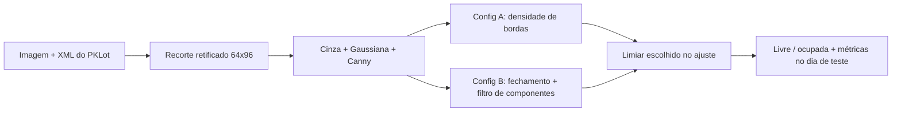

# Proposta — Detecção de Vagas de Estacionamento Livres/Ocupadas

> **Status:** M2 — proposta revisada após a implementação parcial. O texto da M1 foi preservado; o que mudou está sinalizado como **[Revisão M2]** e resumido na Seção 12.
> **Disciplina:** Processamento de Imagens
> **Integrantes:** Guilherme de Alcantara Leite e Gabriel de Andrade Urbano / **GitHub:** guilhermedalcantara e GabrielAndradeU

---

## 1. Problema

O projeto investiga a **classificação automática do estado de vagas individuais em um estacionamento (livre ou ocupada) a partir de imagens capturadas por câmeras fixas** instaladas em posição elevada (ex.: topo de um prédio, poste ou câmera de vigilância voltada para o pátio).

Situação inicial: uma câmera fixa fotografa periodicamente um estacionamento cujas vagas têm posição conhecida (ou podem ser delimitadas manualmente uma única vez, já que a câmera não se move). A ocupação muda ao longo do tempo, entre imagens.

Informação a ser produzida: para cada vaga previamente delimitada em uma imagem, um rótulo binário — **livre** ou **ocupada** — e, de forma agregada, a contagem/percentual de vagas livres no pátio em um dado instante.

O que será **reconhecido** é o estado de ocupação de uma região poligonal fixa da imagem que corresponde a uma vaga, num estacionamento monitorado por câmera fixa, sob variações de iluminação e clima.

## 2. Contexto de aplicação

Sistemas de estacionamento inteligente usam câmeras já instaladas (em vez de sensores por vaga, caros de instalar e manter) para informar quantas vagas estão livres e onde. Aplicações: painéis de disponibilidade em entradas de estacionamentos, redução do tempo gasto procurando vaga e alimentação de aplicativos de navegação/reserva.

O projeto não pretende ser um produto comercial, mas usa um cenário real e bem documentado na literatura, o que permite avaliar objetivamente a qualidade dos resultados.

## 3. Objetivo

**Objetivo geral:** dado um quadro de uma câmera de estacionamento e a delimitação espacial das vagas, classificar automaticamente cada vaga como *livre* ou *ocupada*.

**Objetivos específicos (situação após a M2):**

| # | Objetivo | Situação |
|---|---|---|
| 1 | Pipeline de pré-processamento que reduza a variação entre condições | **[Revisão M2]** Parcial: suavização gaussiana e Canny; normalização de iluminação (equalização/gama) **não** foi utilizada e passa a ser tratada como limitação a analisar |
| 2 | Extrair o recorte de cada vaga | **Concluído** (`src/recorte.py`) |
| 3 | Comparar descritores clássicos + SVM/RF com uma CNN simples | **[Revisão M2]** **Reduzido:** na M2 foram investigados descritores baseados em bordas e morfologia com decisão por limiar; descritores adicionais + classificador raso ficam para a M3; a CNN foi **removida do escopo** |
| 4 | Avaliar generalização entre câmeras e climas | **[Revisão M2]** **Parcial:** a avaliação separa ajuste e teste por dia; câmeras e climas serão analisados na M3 conforme a amostra permitir |
| 5 | Visualização de saída (overlay verde/vermelho) e contagem | **Parcial:** overlay de rótulos reais implementado (`src/anotacoes.py`); overlay de **previsões** e contagem ficam para a M3 |

**[Revisão M2] Justificativa das mudanças:** a M2 tem como foco segmentação, análise de regiões, morfologia e descrição. Concentrar o esforço em uma comparação controlada com técnicas clássicas permitiu medir o efeito de cada operação, o que não seria possível comparando de uma só vez descritores, classificadores e redes neurais.

## 4. Entrada e saída esperadas

**Entrada:** uma imagem do estacionamento e a delimitação geométrica de cada vaga (polígono de 4 pontos), fornecida pelo dataset.

**Saída:** um rótulo binário (`livre`/`ocupada`) por vaga; uma imagem anotada com o contorno de cada vaga colorido conforme o estado; e um resumo numérico (ex.: `42/60 vagas livres`).

```text
imagem + coordenadas das vagas
        ↓
pré-processamento
        ↓
extração dos recortes de cada vaga
        ↓
extração de características
        ↓
classificação (livre / ocupada) por vaga
        ↓
agregação + visualização (overlay + contagem)
```

## 5. Imagens e dados

A proposta apoia-se no **PKLot**, dataset de referência da área, produzido pelo laboratório VRI da UFPR.

- **Origem:** imagens de estacionamentos da UFPR (UFPR04 e UFPR05) e da PUCPR, Curitiba/PR.
- **Obtenção:** download na página oficial do dataset (VRI/UFPR) ou em espelhos redistribuídos (Kaggle, Hugging Face, Roboflow).
- **Conteúdo:** 12.417 imagens completas (1280×720) capturadas ao longo de vários dias em intervalos de 5 minutos, com 695.899 recortes de vagas rotulados, e um XML por imagem com os polígonos das vagas e o estado de ocupação. Os rótulos foram verificados manualmente pelos autores, com a condição climática (ensolarado, nublado, chuvoso).
- **Licença:** CC BY 4.0, com citação obrigatória do artigo do PKLot. O dataset completo **não é redistribuído** no repositório.
- **[Revisão M2] Amostra efetivamente usada na Rodada 1:** 6 imagens (2012-12-07: 4 imagens, 2012-12-12: 2 imagens), 166 vagas rotuladas (5 livres e 161 ocupadas). Detalhes, IDs e divisão ajuste/teste em [`docs/relatorio_m2.md`](relatorio_m2.md), seção 3. Estacionamento/câmera e clima: ⚠️.
- **[Revisão M2] Limitação reconhecida:** a amostra da Rodada 1 tem muito poucas vagas livres e o dia de teste não tem nenhuma. A amostra será ampliada (Rodada 2) para incluir vagas livres e ocupadas em ajuste e teste.
- **[Revisão M2] Correção de inconsistência:** a versão M1 desta proposta mencionava "pelo menos duas câmeras e todas as condições climáticas" na amostra inicial, enquanto o README previa "um mesmo estacionamento e iluminação semelhante". Prevalece o que está documentado no relatório M2, seção 3.
- **[Revisão M2] CNRPark-EXT:** considerado na M1 como dataset secundário de generalização; **removido do escopo** da M2/M3 para concentrar a análise em um único dataset bem caracterizado.

## 6. Pipeline

**[Revisão M2] Pipeline implementado na M2:**



**Pipeline planejado (M3):**


| Etapa | Finalidade | Entrada | Saída | Técnicas | Situação |
|---|---|---|---|---|---|
| Pré-processamento | Reduzir ruído e variação | Recorte | Imagem suavizada | Gaussiana 5×5; equalização/gama avaliadas e não utilizadas | Implementado (parcial) |
| Extração de recortes | Isolar cada vaga | Imagem + XML | Recorte 64×96 | Transformação de perspectiva (OpenCV) | Implementado |
| Segmentação | Marcar contornos do veículo | Recorte | Mapa de bordas | Canny (50/150), margem de 15% | Implementado |
| Morfologia e regiões | Unir bordas e remover ruído | Mapa de bordas | Máscara filtrada | Fechamento 3×3, componentes conectados, área ≥ 8 px | Implementado (Config B) |
| Descrição | Representar a vaga numericamente | Mapa/máscara | Medida escalar | Densidade de bordas; fração coberta por componentes | Implementado |
| Decisão | Livre ou ocupada | Medida | Rótulo | Limiar por acurácia balanceada | Implementado |
| Classificação robusta | Melhorar a separação | Vetor de descritores | Rótulo | Regressão logística/SVM | Planejado (M3) |
| Visualização | Comunicar o resultado | Rótulos | Overlay + contagem | OpenCV | Planejado (M3) |

## 7. Arquitetura

**[Revisão M2]** A arquitetura prevista na M1 (módulos `preprocessing.py`, `patch_extraction.py`, `features.py`, `classifier.py`, `visualize.py`) foi substituída por scripts por responsabilidade, mais adequados ao estágio atual:

| Arquivo | Responsabilidade |
|---|---|
| `src/anotacoes.py` | Leitura do XML, rótulos e overlay das vagas |
| `src/recorte.py` | Retificação por perspectiva de cada vaga |
| `src/diagnostico.py` | Verificação de recortes inválidos |
| `src/medidas.py` | Cálculo da medida (Config A ou B) |
| `src/avaliacao.py` | Escolha do limiar e métricas por conjunto |
| `src/comparar.py` | Comparação controlada A × B |
| `src/figuras.py` | Figuras do relatório |

## 8. Estudo de viabilidade

Evidências reunidas na M1 e confirmadas na M2:

1. **Maturidade do dataset:** amplamente usado na literatura, com acurácias reportadas entre 93% e 98% em cenários controlados.
2. **Anotações prontas:** polígonos e rótulos dispensam anotação manual.
3. **Diversidade de condições:** sol, nublado e chuva permitem planejar experimentos de generalização.
4. **Inspeção:** os polígonos do XML se alinham com as vagas nas imagens usadas; o diagnóstico automático não encontrou recortes fora da imagem (0 sinalizados na Rodada 1).
5. **[Revisão M2] Lição da implementação:** o conjunto de imagens precisa ter vagas livres suficientes; a amostra inicial tinha 5 livres em 166 vagas, o que impediu avaliar a classe de interesse no teste.

## 9. Resultados e experimentos realizados

**[Revisão M2]** Resultados detalhados em [`docs/relatorio_m2.md`](relatorio_m2.md). Resumo da Rodada 1 (preliminar), dia de teste 2012-12-12, 56 vagas ocupadas e nenhuma livre:

| Método | Limiar (ajuste) | Ocupadas classificadas como livres (FP) | Ocupadas corretas (VN) |
|---|---|---|---|
| Config A (bordas brutas) | 0,0832 | 23 | 33 |
| Config B (+ morfologia) | 0,0831 | 12 | 44 |

A Config B reduziu os falsos "livre" nesta amostra, mas o teste não contém vagas livres e o limiar foi estimado com 5 vagas livres; portanto **não há conclusão definitiva**. A Rodada 2, com amostra ampliada, deverá confirmar ou refutar esse indício.

## 10. Uso de Inteligência Artificial generativa

- **Ferramenta:** ChatGPT.
- **Finalidade:** apoio na redação e estruturação desta proposta, do README e do relatório; revisão.
- **Materiais modificados:** `docs/proposta.md`, `README.md`, `docs/relatorio_m2.md`.
- **Verificação:** o grupo executou os scripts, conferiu as saídas e revisou os textos. As decisões técnicas e a interpretação dos resultados são do grupo.

## 11. Referências

- ALMEIDA, P.; OLIVEIRA, L.; SILVA JR., E.; BRITTO JR., A.; KOERICH, A. **PKLot – A robust dataset for parking lot classification**. *Expert Systems with Applications*, 2015.
- AMATO, G. et al. **Deep learning for decentralized parking lot occupancy detection**. *Expert Systems with Applications*, 2017 (CNRPark-EXT).
- CANNY, J. **A computational approach to edge detection**. *IEEE TPAMI*, 1986.
- Página oficial do PKLot (VRI/UFPR) e réplicas públicas (Kaggle, Hugging Face, Roboflow).

## 12. Revisão M2 — o que foi mantido, corrigido ou substituído

| Item da M1 | Situação | Justificativa |
|---|---|---|
| Problema e dataset PKLot | Mantido | — |
| Recorte por vaga | Mantido e implementado | — |
| Característica simples + limiar | Mantido e implementado | Plano declarado para a M2 |
| SVM/RF + descritores clássicos | Adiado para a M3 | Foco da M2 em segmentação e morfologia |
| CNN simples | Removida | Escopo e tempo |
| CNRPark-EXT | Removido | Escopo e tempo |
| Normalização de iluminação | Não utilizada | Analisada como limitação |
| Arquitetura em módulos de `src/` | Substituída por scripts por responsabilidade | Mais simples para o estágio atual |
| Inconsistência câmeras/clima | Corrigida | Seção 5 |

**Resposta ao feedback da M1:** ver [`docs/relatorio_m2.md`](relatorio_m2.md), seção 2.2. ⚠️
